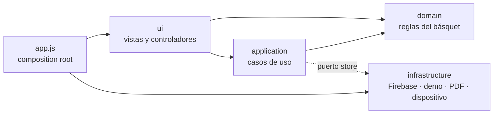

# Sexto Hombre

_La planilla del cuerpo técnico._

**Sexto Hombre** es una app web (PWA) para que el asistente del entrenador cargue un partido de básquet **jugada por jugada desde una tablet**, en el banco y sin depender de la señal. Al final del partido genera la planilla en PDF y la comparte por WhatsApp.

> Estado: **Fase 0 (MVP)**, en construcción.


---

## Qué hace

- **Cancha interactiva.** Tocás dónde ocurrió la jugada, elegís el jugador y la acción. El tiempo de reloj se toma al tocar. La app sugiere doble o triple según la zona.
- **Sabe hacia dónde atacás.** En la previa elegís el aro del primer tiempo; se invierte solo en el 3° cuarto y un indicador sobre la cancha lo muestra (se toca para corregirlo). Si tocás en campo rival aparecen primero las acciones de ataque; en campo propio, las de defensa.
- **Asistencia al toque:** después de cada doble o triple convertido pregunta si hubo asistencia y muestra a los compañeros en cancha.
- **Falta recibida en tiro:** pregunta si fue en tiro, sugiere 2 o 3 libres según la ubicación y abre directo la carga de libres. El 2+1 / 3+1 registra también el canasto.
- **Reloj de juego** con cuartos configurables (6, 8, 10 o 12 minutos), suplementarios de 5 minutos, ajuste manual y pase de período.
- **Todas las acciones de la planilla:** dobles, triples, libres, rebotes, asistencias, robos, tapones, pérdidas (con tipo), faltas personales (con situación de tiro), técnicas, antideportivas y descalificantes, también para el DT y la banca.
- **Reglas FIBA de exclusión:** 5 faltas, 2 técnicas, 2 antideportivas, técnica más antideportiva o descalificante. Si el jugador está en cancha, el reloj se detiene y se pide el **cambio obligatorio**. También avisa la 4ª falta de equipo (penalización).
- **Cambios** con registro de quién entra y quién sale.
- **Historial editable:** corregir o borrar cualquier jugada, y deshacer la última.
- **Planilla en vivo** por jugador, con totales y porcentajes. Se exporta a CSV (historial y planilla).
- **PDF para compartir:** clubes y colores, tanteador, parciales por cuarto, planilla por jugador, faltas de equipo y del cuerpo técnico. Se abre el menú de compartir del sistema para mandarlo por WhatsApp.
- **Planteles guardados:** cargás a tus jugadores una vez. En cada partido elegís el rival, los convocados y el quinteto.
- **Funciona sin señal:** cada jugada se guarda en el dispositivo al instante y se sincroniza cuando vuelve la conexión.
- **Login con Google** y acceso restringido por lista blanca de correos.

## Capturas

<table>
  <tr>
    <td width="50%"><br><sub><b>Cargar una jugada.</b> Ubicación, jugador y acción. Sugiere doble o triple según dónde tocaste.</sub></td>
    <td width="50%"><br><sub><b>Planilla en vivo</b> por jugador, con faltas de equipo y del cuerpo técnico.</sub></td>
  </tr>
  <tr>
    <td width="50%"><br><sub><b>Historial editable.</b> Se corrige o se borra cualquier jugada.</sub></td>
    <td width="50%"><br><sub><b>Previa del partido.</b> Rival, colores, convocados y quinteto.</sub></td>
  </tr>
</table>

Ejemplo de la planilla que se comparte: [`docs/planilla-ejemplo.pdf`](docs/planilla-ejemplo.pdf).

## Probarla en 1 minuto (modo demo)

No hace falta Firebase ni instalar nada. En modo demo los datos quedan en el navegador y se carga un plantel de ejemplo.

```bash
git clone https://github.com/amiretti/sexto-hombre.git
cd sexto-hombre
python3 -m http.server 8080 -d public
```

Abrí **http://localhost:8080/?demo=1**. Funciona mejor en una tablet o con la ventana en horizontal.

Cualquier servidor estático sirve; por ejemplo, `npx serve public`.

## Stack

- **JavaScript sin framework ni build.** Son ES modules nativos y Firebase Hosting sirve `public/` tal cual.
- **Firebase**: Authentication (Google) y Firestore con caché persistente offline. El SDK 10.12.2 se carga desde gstatic.
- **jsPDF 2.5.1 + jsPDF-AutoTable 3.8.2** para la planilla. Están incluidos en `public/vendor/`.
- **Service worker** propio para abrir la app sin señal.
- **Tests** con el runner nativo de Node (`node:test`), sin dependencias.

## Arquitectura

El código sigue una **arquitectura limpia en capas**. Las dependencias apuntan hacia adentro: las reglas del juego no saben nada de la pantalla ni de dónde se guardan los datos.



| Capa | Qué contiene | Depende de |
|---|---|---|
| `shared/` | ids y fechas, escape de HTML, colores | nada |
| `domain/` | catálogo de jugadas, reloj y períodos, geometría de la cancha, estadísticas y exclusiones, plantel, previa y reglas del partido. **Funciones puras, sin DOM.** | `shared` |
| `application/` | sesión del partido (registrar jugadas, consecuencias, guardado con debounce), reporte para el PDF, exportación CSV | `domain` y el **puerto** `store` |
| `infrastructure/` | `store/` (Firebase o demo con la misma interfaz), `pdf/` (render y Web Share), `platform/` (wake lock, portapapeles, service worker, borrador local) | `shared` |
| `ui/` | estado, router de pantallas, despachador único de eventos, vistas (HTML) y controladores (acciones `data-a`) | todo lo anterior |

```
public/
  index.html             carga la app
  app.js                 punto de entrada: arma las dependencias y registra los controladores
  firebase-config.example.js   plantilla de la configuración de Firebase (firebase-config.js no se versiona)
  sw.js                  service worker (lista de módulos en MODULES)
  src/
    shared/  domain/  application/  infrastructure/  ui/
  brand/  fonts/  icons/  vendor/
tests/                   pruebas unitarias de domain, application y el store demo
scripts/                 genera firebase-config.js desde variables de entorno (deploy fuera de Firebase Hosting)
netlify.toml             deploy en Netlify: cabeceras, rutas y proxy del login
firestore.rules          reglas de seguridad
firebase.json            Hosting + Firestore
```

**Algunas decisiones:**

- **El store es un puerto.** `createStore()` devuelve la implementación de Firebase o la demo (localStorage) según la configuración o `?demo=1`. El resto de la app no sabe cuál está usando.
- **Las vistas devuelven HTML como string.** Un despachador central escucha `document` y deriva cada clic a la acción registrada por su `data-a`. Cada pantalla registra sus propias acciones.
- **Nada se borra físicamente.** Borrar una jugada, un partido o un plantel lo marca con `deleted: true`.
- **El PDF se genera de forma sincrónica**, porque `navigator.share` tiene que llamarse dentro del mismo toque del usuario.

## Desarrollo

```bash
npm test          # Node 22 o más nuevo, sin npm install
```

Los tests cubren el dominio (reloj, cancha, estadísticas, exclusiones, faltas de equipo, cambios, edición de jugadas, validaciones) y la capa de aplicación: la sesión del partido con un store falso y timers simulados, el reporte, el CSV y el store demo.

**Al agregar un módulo en `src/`**, sumalo a `MODULES` en `public/sw.js` y subí `VERSION`. Si no, la app instalada no lo va a tener sin señal.

## Despliegue con Firebase

> Esta guía documenta cómo se despliega el proyecto. Para desplegar otra instancia hace falta autorización del autor (ver [Licencia](#licencia)).

1. **Creá un proyecto** en la [consola de Firebase](https://console.firebase.google.com). Alcanza el plan Spark, que es gratis.
2. **Authentication → Método de acceso → Google:** habilitalo y elegí el correo de soporte.
3. **Firestore Database → Crear base de datos:** en modo producción, en la región más cercana. Para Argentina conviene `southamerica-east1` (São Paulo).
4. **Configuración del proyecto → Tus apps → Web (`</>`):** registrá la app, copiá `public/firebase-config.example.js` como `public/firebase-config.js` y completalo con tu configuración. Ese archivo está en `.gitignore`, así que no se sube al repo. Si falta, la app arranca en modo demo.
   - En `authDomain` poné el dominio desde el que vas a servir la app, `TU-PROYECTO.web.app`. Así el login por redirección, que es el que usa la app instalada, funciona en Safari y en navegadores que bloquean cookies de terceros.
   - En Google Cloud Console → APIs y servicios → Credenciales, abrí el cliente OAuth «Web client (auto created by Google Service)». En «URI de redireccionamiento autorizados» agregá `https://TU-PROYECTO.web.app/__/auth/handler`.
5. **Desplegá:**
   ```bash
   npm i -g firebase-tools
   firebase login
   firebase use --add          # elegí tu proyecto (crea .firebaserc; ver .firebaserc.example)
   firebase deploy --only firestore:rules,hosting
   ```
6. **Habilitá a los usuarios (lista blanca):** en Firestore creá la colección `allowlist`. Por cada persona, agregá un documento cuyo ID sea su correo **en minúsculas**, por ejemplo `asistente@ejemplo.com`. El contenido puede quedar vacío. Quien entre con una cuenta que no está en la lista va a ver «Tu cuenta no está habilitada».
7. **En la tablet:** abrí `https://TU-PROYECTO.web.app` en Chrome (Android) o Safari (iPad) y elegí «Agregar a la pantalla de inicio». Instalada, abre en pantalla completa y sin señal.

> La configuración web de Firebase identifica al proyecto, no lo protege: la app publicada la expone igual en el navegador. La seguridad la dan `firestore.rules`, la lista blanca, los dominios autorizados de Authentication y las restricciones de la API key en Google Cloud Console (limitarla a tus dominios).

### Hosting alternativo: Netlify

`netlify.toml` publica `public/` y en cada deploy genera `firebase-config.js` con `scripts/write-firebase-config.mjs`, a partir de estas variables de entorno: `FIREBASE_API_KEY`, `FIREBASE_AUTH_DOMAIN`, `FIREBASE_PROJECT_ID`, `FIREBASE_STORAGE_BUCKET`, `FIREBASE_MESSAGING_SENDER_ID` y `FIREBASE_APP_ID`.

- `FIREBASE_AUTH_DOMAIN` tiene que ser el dominio de Netlify. Las rutas `/__/auth/*` se reenvían a `TU-PROYECTO.firebaseapp.com`, así el login por redirección funciona en Safari y en la app instalada. En `netlify.toml`, reemplazá `sexto-hombre` por el ID de tu proyecto.
- Agregá el dominio de Netlify en Authentication → Dominios autorizados y `https://TU-SITIO.netlify.app/__/auth/handler` en los URI de redireccionamiento del cliente OAuth.
- Las reglas de Firestore se siguen publicando con `firebase deploy --only firestore:rules`.

### Datos en Firestore

| Ruta | Contenido |
|---|---|
| `allowlist/{correo}` | Correos habilitados (se cargan a mano) |
| `users/{uid}` | Perfil del usuario |
| `teams/{id}` | Plantel: nombre, color, DT, competición, duración por defecto, jugadores (`id`, `num`, `name`, `active`) y último quinteto |
| `games/{id}` | Partido: plantel de origen, local o visitante, equipos y colores, convocados (copia del plantel al empezar), en cancha, período, reloj, puntos del rival por período, estado y resumen del tanteador |
| `games/{id}/events/{id}` | Una jugada por documento, con ID generado en el dispositivo, `seq`, `rev` y `deleted` |

## Sin señal

Firestore usa caché persistente: cada jugada se guarda al instante en el dispositivo y se envía sola cuando vuelve la conexión. La barra muestra «Guardado» o «N sin enviar». El service worker guarda la app, que abre sin señal después de haberse abierto una vez con conexión.

Al tocar «Salir» se borran del dispositivo la caché de Firestore y los datos locales de la app, pensando en tablets compartidas. Si quedan cambios sin enviar, la app avisa antes, porque se perderían.

## Compartir por WhatsApp

«Compartir PDF» genera la planilla en el dispositivo y abre el menú de compartir del sistema, donde se elige WhatsApp. Una web no puede mandarle un archivo directo a WhatsApp, por eso pasa por ese menú. En una computadora sin menú de compartir, el PDF se descarga. Al finalizar el partido, la app ofrece compartirlo.

## Límites conocidos (Fase 0)

- **Un dispositivo por partido.** Si se abre el mismo partido en dos tablets a la vez, una puede pisar el reloj y los jugadores en cancha de la otra.
- **El tanteador del rival es manual.** El pase a suplementario depende de que esté bien cargado.
- **Las reglas de Firestore no se probaron contra el emulador.** Antes de un uso real conviene verificar que un correo fuera de la lista no ve nada y que un usuario habilitado no puede leer los partidos de otro.
- La interfaz está solo en español (Argentina).

## Créditos

- Tipografías [Saira Condensed](https://fonts.google.com/specimen/Saira+Condensed) e [IBM Plex Sans](https://fonts.google.com/specimen/IBM+Plex+Sans), bajo licencia SIL Open Font License (ver `public/fonts/`).
- [jsPDF](https://github.com/parallax/jsPDF) y [jsPDF-AutoTable](https://github.com/simonbengtsson/jsPDF-AutoTable), bajo licencia MIT (ver `public/vendor/`).

## Licencia

© 2026 Andrés Miretti. **Todos los derechos reservados.**

El código se publica solo para que se pueda ver. No es software libre ni open source. Sin autorización por escrito no se permite usarlo, copiarlo, modificarlo, distribuirlo, ofrecerlo como servicio ni desplegarlo. La única excepción es correrlo en tu computadora en modo demo para evaluarlo en forma personal. Los términos completos están en [`LICENSE`](LICENSE).

¿Te interesa usarlo en tu club o liga? Escribime a través de [GitHub](https://github.com/amiretti).

Hecho por [Andrés Miretti](https://github.com/amiretti).
