# Sexto Hombre

_La planilla del cuerpo técnico._

**Sexto Hombre** es una app web (PWA) para que el asistente del entrenador cargue un partido de básquet **jugada por jugada desde una tablet**, en el banco y sin depender de la señal. Al final del partido genera la planilla en PDF y la comparte por WhatsApp.

> Estado: **Fase 0 (MVP) terminada** (noviembre 2026). Cubre el partido completo, la planilla compartible, la organización del club y los informes de la temporada. Lo que todavía no hace está en [Límites conocidos](#límites-conocidos-fase-0).

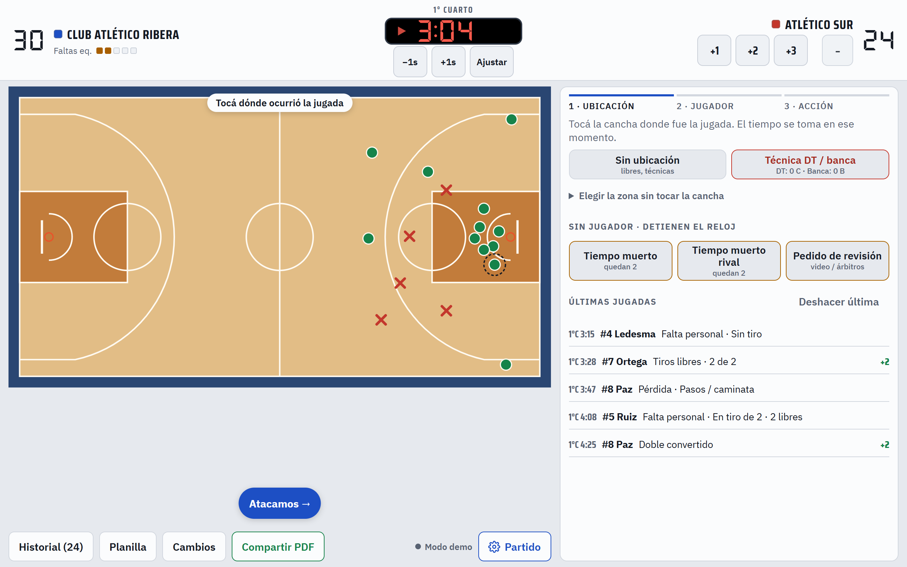

---

## Qué hace

### Durante el partido

- **Dos tipos de planilla, a elección en la previa.** La **avanzada** usa la cancha: ubicación de cada jugada, mapa de tiros y el detalle de faltas y pérdidas. La **básica** es solo una botonera, sin cancha: simple, doble y triple (convertido o errado), rebote en ataque o en defensa, tapón, robo, pérdida, falta cometida y falta recibida (con cuántos libres). Se toca la acción y después el jugador; tras un gol pregunta la asistencia igual que la avanzada. Las dos llevan el reloj, los cambios, los minutos, las faltas de equipo y del rival, la planilla y el PDF (la básica, sin la página del mapa). La previa propone la que usó el plantel la última vez y no se cambia una vez empezado el partido.
- **Cancha interactiva.** Tocás dónde ocurrió la jugada, elegís el jugador y la acción. El tiempo de reloj se toma al tocar. La app sugiere doble o triple según la zona.
- **Sabe hacia dónde atacás.** En la previa elegís el aro del primer tiempo; se invierte solo en el 3° cuarto y un indicador sobre la cancha lo muestra (se toca para corregirlo). Si tocás en campo rival aparecen primero las acciones de ataque; en campo propio, las de defensa.
- **Asistencia al toque:** después de cada doble o triple convertido pregunta si hubo asistencia y muestra a los compañeros en cancha.
- **Falta recibida en tiro:** pregunta si fue en tiro, sugiere 2 o 3 libres según la ubicación y abre directo la carga de libres. El 2+1 / 3+1 registra también el canasto.
- **Faltas del rival y penalización:** cada falta recibida suma una falta de equipo del rival en el cuarto (los suplementarios cuentan con el 4°) y el tablero las muestra junto a las nuestras. Con el rival en penalización (4 o más), una falta recibida sin tiro propone directo los 2 libres; si fue en ataque del rival, se carga sin libres.
- **Reloj de juego** con cuartos configurables (6, 8, 10 o 12 minutos), suplementarios de 5 minutos, ajuste manual y pase de período.
- **Chicharra** al terminar cada período, como en el estadio (sintetizada, funciona sin señal; se silencia desde el menú del partido).
- **Reloj que no se olvida:** si se carga una acción con la pelota viva (tiro, rebote, asistencia, robo, tapón) y el reloj estaba detenido, lo pone a correr y ofrece sincronizarlo con el tablero; las jugadas cargadas mientras estaba detenido se corrigen solas. Faltas, libres, violaciones y tiempos muertos no lo arrancan.
- **Todas las acciones de la planilla:** dobles, triples, libres, rebotes, asistencias, robos, tapones, pérdidas (con tipo), faltas personales (con situación de tiro), técnicas, antideportivas y descalificantes, también para el DT y la banca.
- **Reglas FIBA de exclusión:** 5 faltas, 2 técnicas, 2 antideportivas, técnica más antideportiva o descalificante. Si el jugador está en cancha, el reloj se detiene y se pide el **cambio obligatorio**. También avisa la 4ª falta de equipo (penalización).
- **Cambios** con registro de quién entra y quién sale.
- **Tiempos muertos y pedidos de revisión** con un toque: detienen el reloj en el acto. Lleva la cuenta de tiempos muertos de cada equipo según FIBA (2 en el primer tiempo, 3 en el segundo, 1 por suplementario).
- **Pérdidas de equipo:** los 24 segundos y los 8 segundos para pasar la mitad se cargan con un toque, sin jugador ni ubicación (como en las estadísticas FIBA). Detienen el reloj y suman en la fila Equipo de la planilla.
- **Historial editable:** corregir o borrar cualquier jugada, y deshacer la última.
- **Tablero tipo estadio:** tanteador y reloj con dígitos de 7 segmentos (DSEG7), que siguen el modo claro u oscuro. La hoja «Partido» (botón con engranaje) agrupa la planilla, los ajustes (tema y chicharra) y el cierre del partido.
- **Minutos jugados:** mientras el jugador está en cancha suma tiempo de reloj; cuando sale, deja de sumar. Se calcula con el quinteto inicial, los cambios y el reloj, así que también aparece en los partidos ya jugados. Se ve en la planilla, en el PDF, en el CSV y al hacer cambios.
- **Planilla en vivo** por jugador, con minutos, totales y porcentajes. Se exporta a CSV (historial y planilla).
- **PDF para compartir:** clubes y colores, tanteador, parciales por cuarto, planilla por jugador, faltas de equipo y del cuerpo técnico, y una segunda página con el mapa de tiros del partido (convertidos y errados en media cancha, con la tabla por zona). Se abre el menú de compartir del sistema para mandarlo por WhatsApp.

### Fuera del partido

- **Inicio por secciones:** Inicio, Partidos, Club y Competiciones. En celular el menú va en una barra fija abajo y en tablet o computadora, en pestañas.
- **Borrar un partido deslizando:** en Partidos, deslizás la tarjeta hacia la izquierda y aparece «Borrar». Al tocarlo el partido se borra y el aviso ofrece **Deshacer**. Con mouse o teclado también está el tachito, que pide un segundo toque.
- **Resumen de la temporada** en Inicio: partido en curso (para continuarlo), récord G-P con promedio a favor, en contra y diferencia, últimos 5 resultados y líderes del plantel en puntos, rebotes y asistencias por partido.
- **Clubes y planteles:** el club guarda el nombre, los colores (titular y alternativo) y los estadios; cada club tiene uno o más planteles, cada uno con su categoría (Mini a Maxi) y rama (masculino, femenino o mixto) y sus jugadores. En cada partido elegís el plantel, el rival, los convocados y el quinteto.
- **Competiciones:** ligas y torneos con temporada y duración del cuarto. Se eligen al crear cada partido (o «Amistoso»), proponen su duración y el plantel recuerda la última que usó. Se crean desde Mis partidos o desde la previa.
- **Camiseta:** se propone la titular del club; si se parece al color del rival, pasás a la alternativa con un toque.
- **Estadios:** cada club guarda sus canchas (nombre y ubicación). Podés marcar una por defecto, que se propone en cada partido de local y se cambia si hace falta; queda en la lista de partidos y en la planilla.
- **Informes:** por plantel, con filtros de jugador (o todo el equipo), competición y fechas.
  - *Mapa de tiros:* todos los tiros de campo llevados a una misma media cancha (se tiene en cuenta hacia dónde se atacaba en cada cuarto) y agrupados en 12 zonas. Se colorea por **volumen** (desde dónde se tira más) o por **acierto**: «normal» es un punto por tiro (50% en dobles, 33% en triples) y en rojo queda donde más se erra para lo que vale el tiro. Debajo, la tabla por zona.
  - *Progreso:* gráfico de línea partido a partido de puntos, minutos jugados (por jugador), rebotes, asistencias, robos, tapones, pérdidas, faltas cometidas y recibidas, triples y porcentajes de tiro, con el promedio y la tabla de valores.
  - *Exportar:* a **PDF** (resumen por partido con promedios y récord, más el mapa de tiros) o a **Excel** (.xlsx, con las hojas «Por partido» y «Tiros por zona»), según los filtros aplicados. En celular se abre el menú de compartir.

### En general

- **Funciona sin señal:** cada jugada se guarda en el dispositivo al instante y se sincroniza cuando vuelve la conexión.
- **Modo claro y oscuro:** interruptor con sol y luna en el inicio y en el menú del partido. Mientras no elijas, sigue al sistema; lo que elijas queda guardado en el dispositivo.
- **Accesible:** se puede usar con teclado y lector de pantalla (WCAG 2.2 AA; axe-core sin violaciones en modo claro y oscuro).
- **Login con Google** y acceso restringido por lista blanca de correos.

## Capturas

Datos de ejemplo del modo demo.

### Tablet y computadora

<table>
  <tr>
    <td width="50%">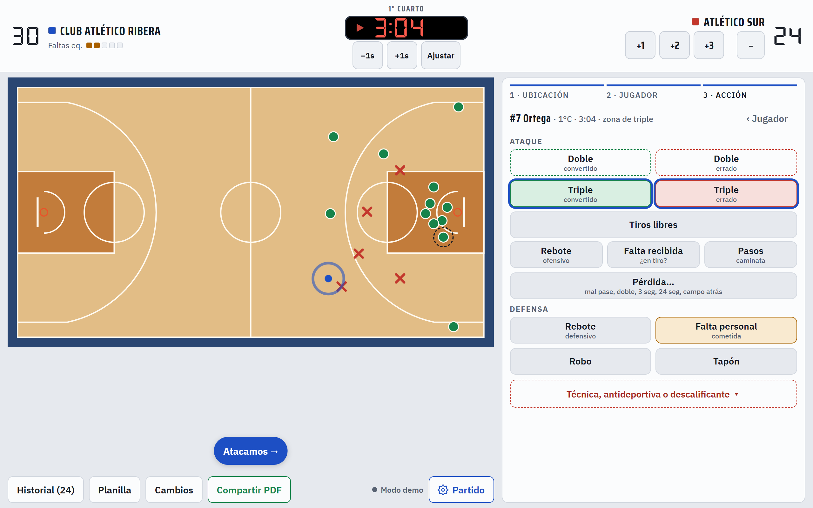<br><sub><b>Cargar una jugada.</b> Ubicación, jugador y acción. Sugiere doble o triple según dónde tocaste.</sub></td>
    <td width="50%">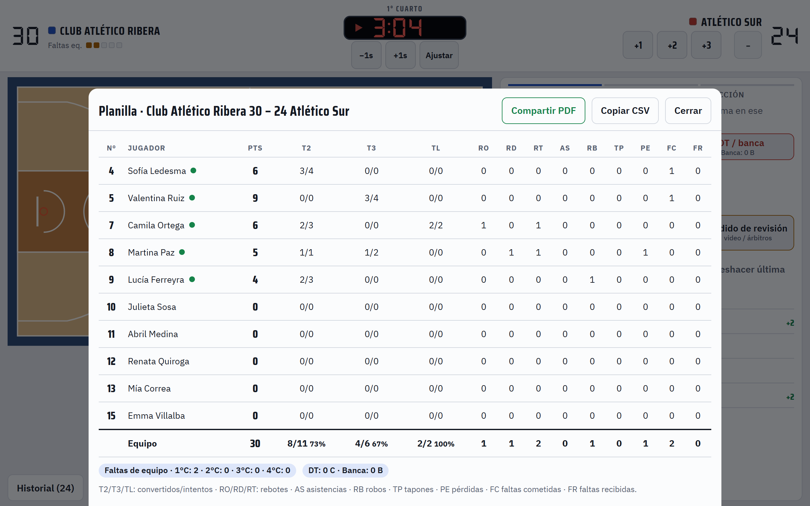<br><sub><b>Planilla en vivo</b> por jugador, con faltas de equipo y del cuerpo técnico.</sub></td>
  </tr>
  <tr>
    <td width="50%">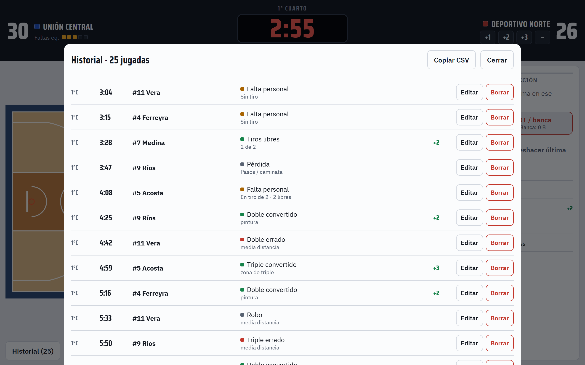<br><sub><b>Historial editable.</b> Se corrige o se borra cualquier jugada.</sub></td>
    <td width="50%">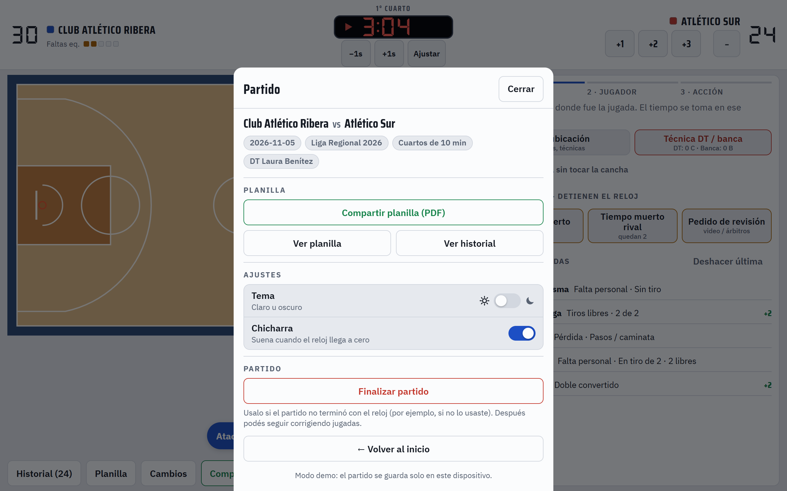<br><sub><b>Hoja «Partido».</b> Planilla, tema, chicharra y cierre del partido.</sub></td>
  </tr>
  <tr>
    <td width="50%">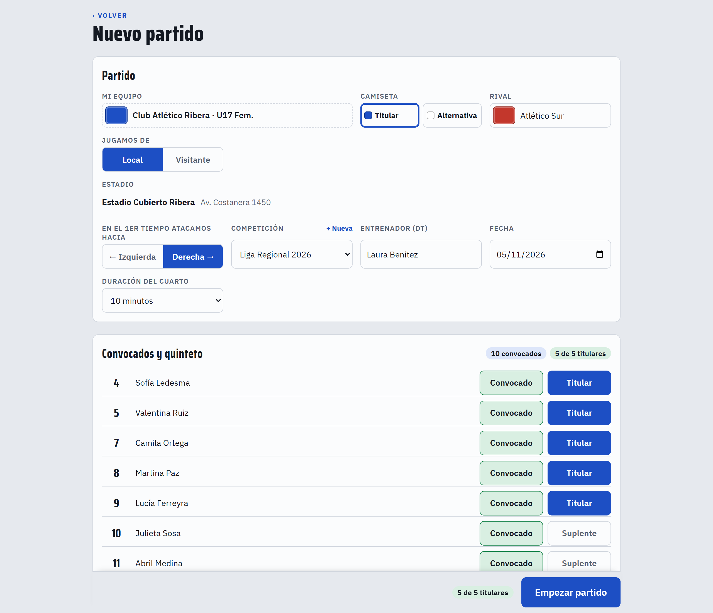<br><sub><b>Previa del partido.</b> Rival, camiseta, estadio, competición, convocados y quinteto.</sub></td>
    <td width="50%">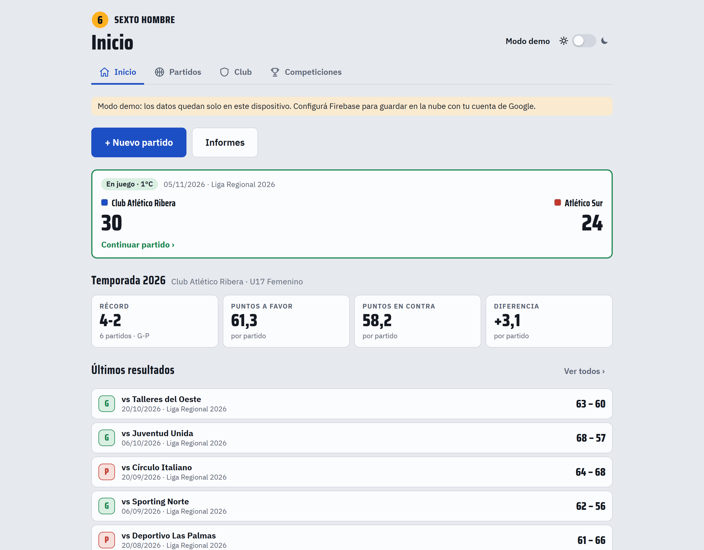<br><sub><b>Inicio.</b> Partido en curso, récord de la temporada y últimos resultados.</sub></td>
  </tr>
  <tr>
    <td width="50%">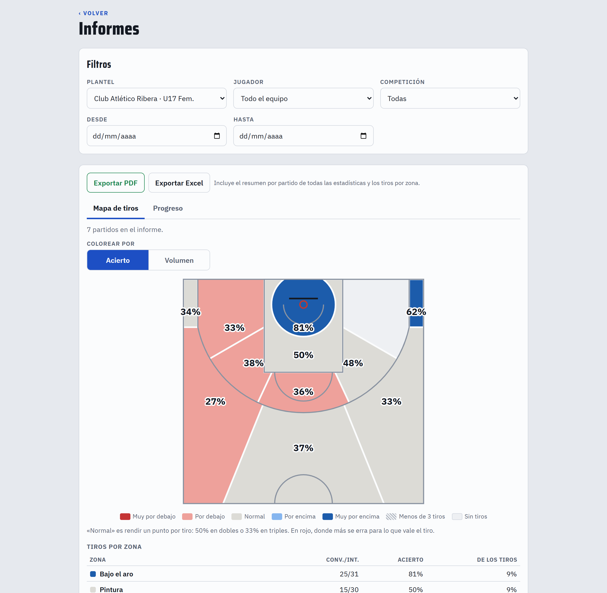<br><sub><b>Mapa de tiros</b> por zonas, coloreado por acierto o por volumen.</sub></td>
    <td width="50%">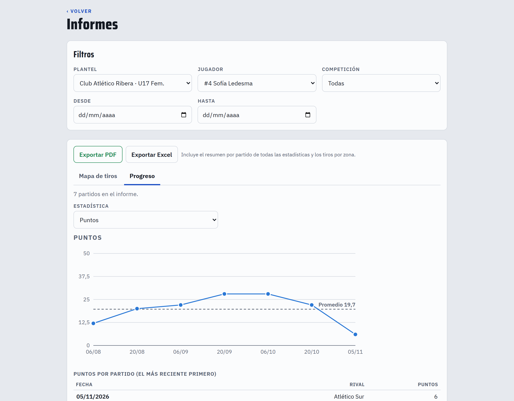<br><sub><b>Progreso</b> partido a partido, con el promedio.</sub></td>
  </tr>
</table>

### Celular

<table>
  <tr>
    <td width="33%">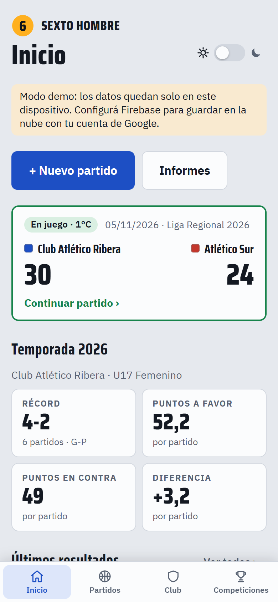<br><sub><b>Inicio</b> con el menú de secciones abajo.</sub></td>
    <td width="33%">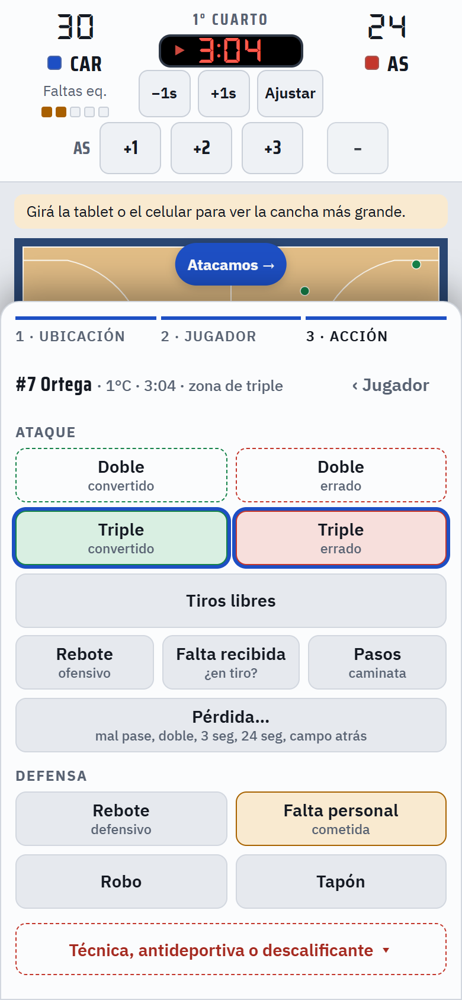<br><sub><b>Cargar una jugada</b> desde la hoja de abajo.</sub></td>
    <td width="33%">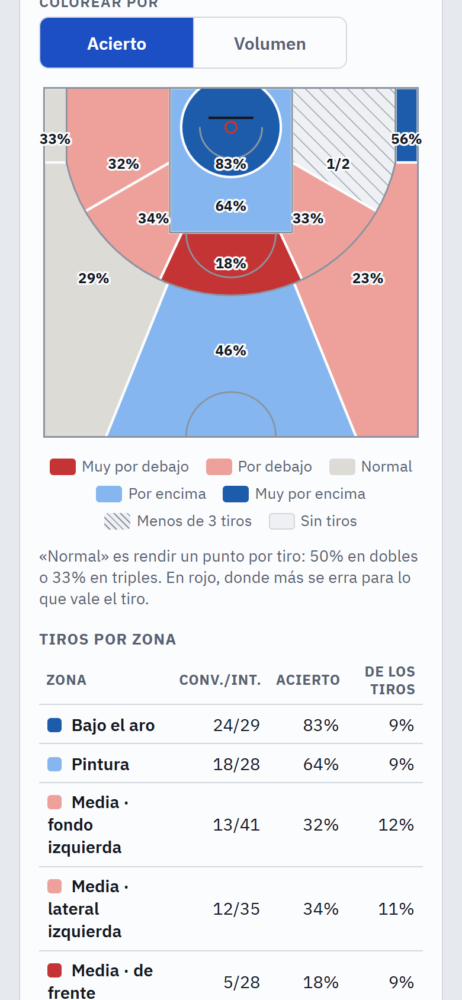<br><sub><b>Informes</b> en pantalla chica.</sub></td>
  </tr>
</table>

<table>
  <tr>
    <td width="50%">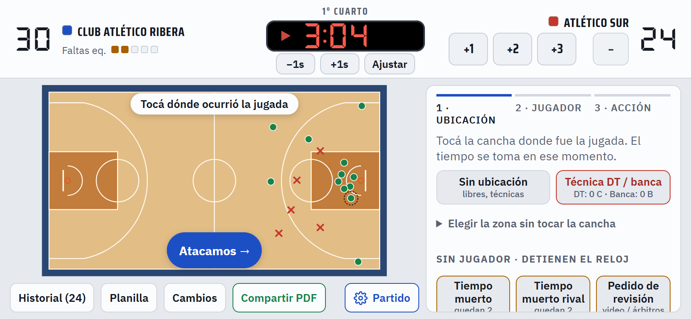<br><sub><b>En horizontal,</b> la cancha y el panel lado a lado.</sub></td>
    <td width="50%">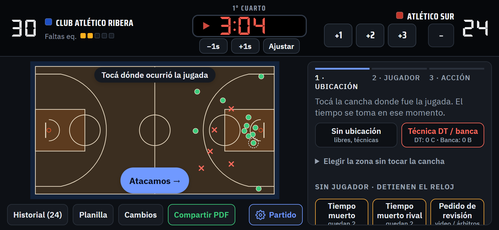<br><sub><b>Modo oscuro.</b></sub></td>
  </tr>
</table>

Ejemplo de la planilla que se comparte: [`docs/planilla-ejemplo.pdf`](docs/planilla-ejemplo.pdf).

## Probarla en 1 minuto (modo demo)

No hace falta Firebase ni instalar nada. En modo demo los datos quedan en el navegador y se cargan un club y un plantel de ejemplo.

```bash
git clone https://github.com/amiretti/sexto-hombre.git
cd sexto-hombre
python3 -m http.server 8080 -d public
```

Abrí **http://localhost:8080/?demo=1**. Funciona mejor en una tablet o con la ventana en horizontal.

Cualquier servidor estático sirve; por ejemplo, `npx serve public`.

## Stack

- **JavaScript sin framework ni build.** Son ES modules nativos y Firebase Hosting sirve `public/` tal cual.
- **Firebase**: Authentication (Google) y Firestore con caché persistente offline. El SDK 10.12.2 se carga desde gstatic.
- **jsPDF 2.5.1 + jsPDF-AutoTable 3.8.2** para la planilla y los informes. Están incluidos en `public/vendor/`.
- **Excel sin librerías:** el .xlsx se arma en el navegador como un ZIP de XML (SpreadsheetML).
- **Gráficos en SVG propio** (mapa de tiros y líneas de progreso), sin librerías de gráficos.
- **Service worker** propio para abrir la app sin señal.
- **Tests** con el runner nativo de Node (`node:test`), sin dependencias.

## Arquitectura

El código sigue una **arquitectura limpia en capas**. Las dependencias apuntan hacia adentro: las reglas del juego no saben nada de la pantalla ni de dónde se guardan los datos.

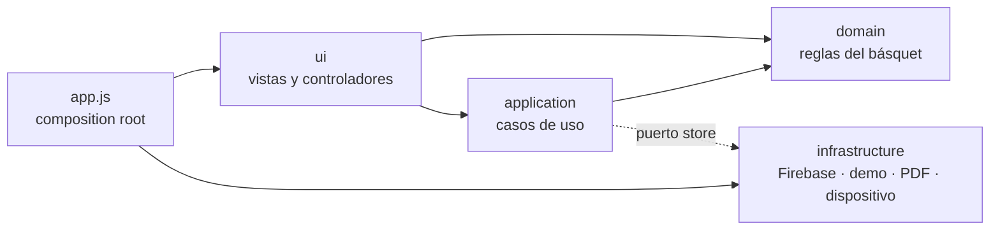

| Capa | Qué contiene | Depende de |
|---|---|---|
| `shared/` | ids y fechas, escape de HTML, colores | nada |
| `domain/` | catálogo de jugadas, reloj y períodos, geometría de la cancha, zonas del mapa de tiros, estadísticas y exclusiones, progreso por partido, resumen de la temporada, club, plantel, competición, previa y reglas del partido. **Funciones puras, sin DOM.** | `shared` |
| `application/` | sesión del partido (registrar jugadas, consecuencias, guardado con debounce), bloqueo del partido a un dispositivo, reporte para el PDF, partidos de los informes y su exportación, exportación CSV, migración de datos viejos | `domain` y el **puerto** `store` |
| `infrastructure/` | `store/` (Firebase o demo con la misma interfaz), `pdf/` (render y Web Share), `xlsx/` (escritor de Excel), `platform/` (wake lock, portapapeles, service worker, borrador local) | `shared` |
| `ui/` | estado, router de pantallas, despachador único de eventos, vistas (HTML) y controladores (acciones `data-a`) | todo lo anterior |

```
public/
  index.html             carga la app
  app.js                 punto de entrada: arma las dependencias y registra los controladores
  firebase-config.example.js   plantilla de la configuración de Firebase (firebase-config.js no se versiona)
  sw.js                  service worker (lista de módulos en MODULES)
  src/
    shared/  domain/  application/  infrastructure/  ui/
  brand/  fonts/  icons/  vendor/
tests/                   pruebas unitarias de domain, application y el store demo
scripts/                 genera firebase-config.js desde variables de entorno (deploy fuera de Firebase Hosting)
netlify.toml             deploy en Netlify: cabeceras, rutas y proxy del login
firestore.rules          reglas de seguridad
firebase.json            Hosting + Firestore
```

**Algunas decisiones:**

- **El store es un puerto.** `createStore()` devuelve la implementación de Firebase o la demo (localStorage) según la configuración o `?demo=1`. El resto de la app no sabe cuál está usando.
- **Las vistas devuelven HTML como string.** Un despachador central escucha `document` y deriva cada clic a la acción registrada por su `data-a`. Cada pantalla registra sus propias acciones.
- **Nada se borra físicamente.** Borrar una jugada, un partido, un plantel o un club lo marca con `deleted: true`.
- **El PDF se genera de forma sincrónica**, porque `navigator.share` tiene que llamarse dentro del mismo toque del usuario.

## Desarrollo

```bash
npm test          # Node 22 o más nuevo, sin npm install
```

Son 128 tests. Cubren el dominio (reloj, cancha, dirección de ataque, tipo de planilla, estadísticas, minutos jugados, exclusiones, faltas de equipo y del rival, pérdidas de equipo, cambios, edición de jugadas, clubes, competiciones, mapa de tiros, progreso, resumen de la temporada, validaciones) y la capa de aplicación: la sesión del partido con un store falso y timers simulados, el bloqueo por dispositivo, el reporte, la exportación de informes (incluido el ZIP del .xlsx), el CSV y el store demo.

**Al agregar un módulo en `src/`**, sumalo a `MODULES` en `public/sw.js` y subí `VERSION`. Si no, la app instalada no lo va a tener sin señal.

## Despliegue con Firebase

> Esta guía documenta cómo se despliega el proyecto. Para desplegar otra instancia hace falta autorización del autor (ver [Licencia](#licencia)).

1. **Creá un proyecto** en la [consola de Firebase](https://console.firebase.google.com). Alcanza el plan Spark, que es gratis.
2. **Authentication → Método de acceso → Google:** habilitalo y elegí el correo de soporte.
3. **Firestore Database → Crear base de datos:** en modo producción, en la región más cercana. Para Argentina conviene `southamerica-east1` (São Paulo).
4. **Configuración del proyecto → Tus apps → Web (`</>`):** registrá la app, copiá `public/firebase-config.example.js` como `public/firebase-config.js` y completalo con tu configuración. Ese archivo está en `.gitignore`, así que no se sube al repo. Si falta, la app arranca en modo demo.
   - En `authDomain` poné el dominio desde el que vas a servir la app, `TU-PROYECTO.web.app`. Así el login por redirección, que es el que usa la app instalada, funciona en Safari y en navegadores que bloquean cookies de terceros.
   - En Google Cloud Console → APIs y servicios → Credenciales, abrí el cliente OAuth «Web client (auto created by Google Service)». En «URI de redireccionamiento autorizados» agregá `https://TU-PROYECTO.web.app/__/auth/handler`.
5. **Desplegá:**
   ```bash
   npm i -g firebase-tools
   firebase login
   firebase use --add          # elegí tu proyecto (crea .firebaserc; ver .firebaserc.example)
   firebase deploy --only firestore:rules,hosting
   ```
6. **Habilitá a los usuarios (lista blanca):** en Firestore creá la colección `allowlist`. Por cada persona, agregá un documento cuyo ID sea su correo **en minúsculas**, por ejemplo `asistente@ejemplo.com`. El contenido puede quedar vacío. Quien entre con una cuenta que no está en la lista va a ver «Tu cuenta no está habilitada».
7. **En la tablet:** abrí `https://TU-PROYECTO.web.app` en Chrome (Android) o Safari (iPad) y elegí «Agregar a la pantalla de inicio». Instalada, abre en pantalla completa y sin señal.

> La configuración web de Firebase identifica al proyecto, no lo protege: la app publicada la expone igual en el navegador. La seguridad la dan `firestore.rules`, la lista blanca, los dominios autorizados de Authentication y las restricciones de la API key en Google Cloud Console (limitarla a tus dominios).

### Hosting alternativo: Netlify

`netlify.toml` publica `public/` y en cada deploy genera `firebase-config.js` con `scripts/write-firebase-config.mjs`, a partir de estas variables de entorno: `FIREBASE_API_KEY`, `FIREBASE_AUTH_DOMAIN`, `FIREBASE_PROJECT_ID`, `FIREBASE_STORAGE_BUCKET`, `FIREBASE_MESSAGING_SENDER_ID` y `FIREBASE_APP_ID`.

- `FIREBASE_AUTH_DOMAIN` tiene que ser el dominio de Netlify. Las rutas `/__/auth/*` se reenvían a `TU-PROYECTO.firebaseapp.com`, así el login por redirección funciona en Safari y en la app instalada. En `netlify.toml`, reemplazá `sexto-hombre` por el ID de tu proyecto.
- Agregá el dominio de Netlify en Authentication → Dominios autorizados y `https://TU-SITIO.netlify.app/__/auth/handler` en los URI de redireccionamiento del cliente OAuth.
- Las reglas de Firestore se siguen publicando con `firebase deploy --only firestore:rules`.

### Datos en Firestore

| Ruta | Contenido |
|---|---|
| `allowlist/{correo}` | Correos habilitados (se cargan a mano) |
| `users/{uid}` | Perfil del usuario |
| `clubs/{id}` | Club: nombre, color titular (`color`) y alternativo (`altColor`), estadios (`id`, `name`, `location`) y estadio por defecto (`defaultVenueId`) |
| `competitions/{id}` | Competición: nombre, temporada (`season`) y duración del cuarto (`periodMin`) |
| `teams/{id}` | Plantel: club (`clubId`), categoría y rama (`branch`: `m`, `f` o `x`), DT, última competición usada (`lastCompetitionId`), duración por defecto, jugadores (`id`, `num`, `name`, `active`) y último quinteto |
| `games/{id}` | Partido: plantel y club de origen, categoría, competición (id y copia del nombre), local o visitante, estadio (copia de nombre y ubicación, solo de local), equipos y colores, convocados (copia del plantel al empezar), en cancha, período, reloj, puntos del rival por período, estado, tipo de planilla (`sheet`: `full` o `basic`; sin el campo, avanzada) y resumen del tanteador |
| `games/{id}/events/{id}` | Una jugada por documento, con ID generado en el dispositivo, `seq`, `rev` y `deleted` |

Los planteles creados antes de que existieran los clubes se migran solos al abrir la app: se agrupan por nombre en un club (con su color y sus estadios) y quedan con la categoría «Primera», que se puede editar. Las competiciones que estaban escritas en el plantel pasan a ser competiciones de la temporada actual, y las categorías escritas a mano se interpretan («U17 Femenino» queda como U17, rama femenina). Los partidos ya jugados no cambian.

## Sin señal

Firestore usa caché persistente: cada jugada se guarda al instante en el dispositivo y se envía sola cuando vuelve la conexión. La barra muestra «Guardado» o «N sin enviar». El service worker guarda la app, que abre sin señal después de haberse abierto una vez con conexión.

Al tocar «Salir» se borran del dispositivo la caché de Firestore y los datos locales de la app, pensando en tablets compartidas. Si quedan cambios sin enviar, la app avisa antes, porque se perderían.

## Compartir por WhatsApp

«Compartir PDF» genera la planilla en el dispositivo y abre el menú de compartir del sistema, donde se elige WhatsApp. Una web no puede mandarle un archivo directo a WhatsApp, por eso pasa por ese menú. En una computadora sin menú de compartir, el PDF se descarga. Al finalizar el partido, la app ofrece compartirlo.

## Límites conocidos (Fase 0)

- **Un dispositivo por partido.** El partido se carga desde un solo dispositivo (o pestaña) a la vez: si está abierto en otro, la app avisa y ofrece «Abrir acá igual», que hace que el otro deje de guardar. El bloqueo se renueva cada 30 s y vence solo a los 90 s si el dispositivo se apaga. No hay sincronización en vivo entre dispositivos.
- **El tanteador del rival es manual.** El pase a suplementario depende de que esté bien cargado.
- **Las faltas del rival salen de las faltas recibidas.** Si una falta del rival no se carga como falta recibida (o es una técnica de un jugador rival), no suma para la penalización.
- **Las reglas de Firestore no se probaron contra el emulador.** Antes de un uso real conviene verificar que un correo fuera de la lista no ve nada y que un usuario habilitado no puede leer los partidos de otro.
- **Los minutos dependen del reloj.** Si el reloj no se usa, cada cuarto terminado cuenta completo para los que estaban en cancha. El progreso muestra totales por partido (no promedios por minuto).
- **Tiros sin ubicación:** cuentan en los totales pero no en las zonas del mapa. Los partidos con planilla básica no entran en el mapa de tiros de los informes.
- **La planilla básica no distingue tipos de falta ni de pérdida.** Toda falta cometida cuenta como personal (no detecta técnicas ni antideportivas) y las pérdidas quedan «sin detalle».
- **Los informes leen cada partido con sus jugadas.** La primera vez se piden al servidor (o a la caché del dispositivo); después quedan en memoria mientras el partido no cambie.
- La interfaz está solo en español (Argentina).

## Créditos

- Tipografías [Saira Condensed](https://fonts.google.com/specimen/Saira+Condensed), [IBM Plex Sans](https://fonts.google.com/specimen/IBM+Plex+Sans) y [DSEG7](https://github.com/keshikan/DSEG), bajo licencia SIL Open Font License (ver `public/fonts/`).
- [jsPDF](https://github.com/parallax/jsPDF) y [jsPDF-AutoTable](https://github.com/simonbengtsson/jsPDF-AutoTable), bajo licencia MIT (ver `public/vendor/`).

## Licencia

© 2026 Andrés Miretti. **Todos los derechos reservados.**

El código se publica solo para que se pueda ver. No es software libre ni open source. Sin autorización por escrito no se permite usarlo, copiarlo, modificarlo, distribuirlo, ofrecerlo como servicio ni desplegarlo. La única excepción es correrlo en tu computadora en modo demo para evaluarlo en forma personal. Los términos completos están en [`LICENSE`](LICENSE).

¿Te interesa usarlo en tu club o liga? Escribime a través de [GitHub](https://github.com/amiretti).

Hecho por [Andrés Miretti](https://github.com/amiretti).
